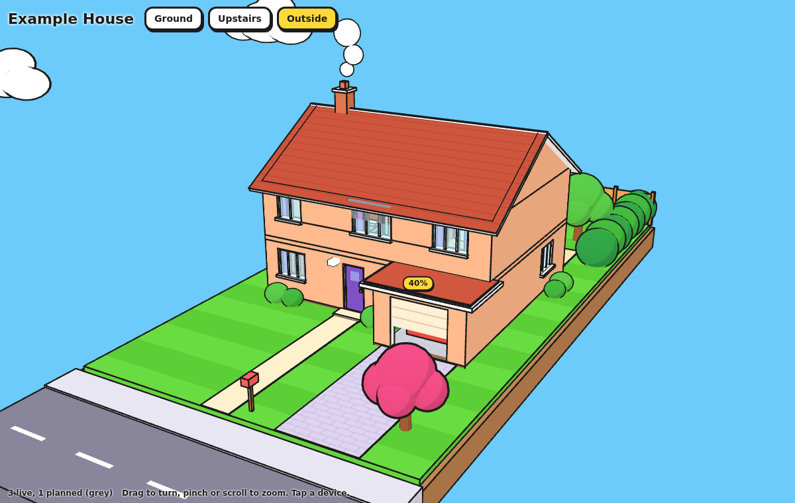
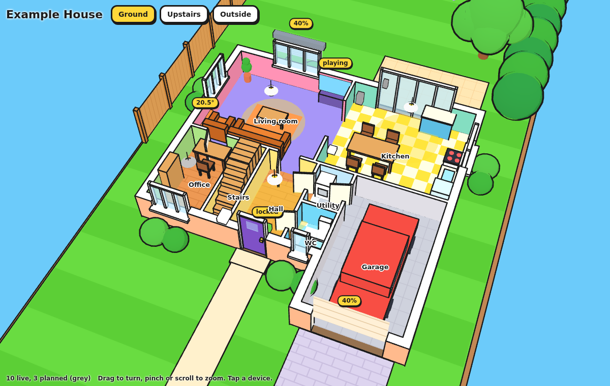
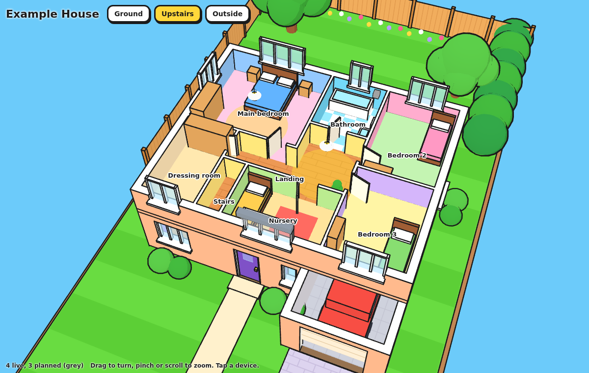
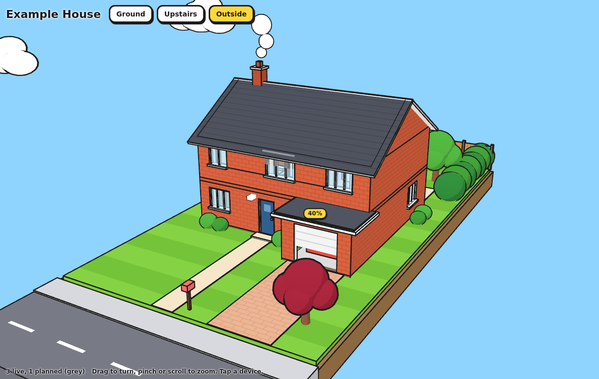
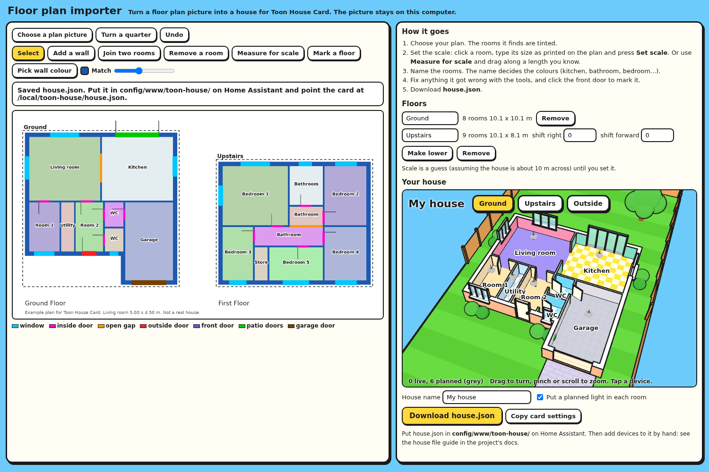

# Toon House Card

A cartoon 3D dollhouse of your home for Home Assistant. You describe your rooms, doors and windows in metres; the card builds the house, the roof and the garden, and puts your lights, blinds, radiators, locks and cameras where they really are.



| Ground floor | Upstairs | "brick" theme |
|---|---|---|
|  |  |  |

## What it does

- **Start from a picture.** An importer page reads a floor plan image and drafts the house for you.
- **Your floor plan, in 3D.** Flat cartoon colours, thick ink outlines, patterned floors, a blue sky with puffy clouds.
- **Three kinds of view.** One cutaway per floor (walls cut low so you can see in), and the whole house from outside with the roof on. Drag to turn, pinch or scroll to zoom.
- **Devices in the right place.** A blind sits on its window and its slats move with the real position. Lights glow and light the floor. Radiators turn orange when heating. The garage door opens.
- **Tap to control.** Tapping a light or switch toggles it. Tapping anything else opens its normal Home Assistant details.
- **Plan ahead.** A device with no entity is drawn grey as "planned", so you can lay out kit you have not bought yet.
- **One file, no internet.** The 3D library is bundled in, so it works on a local-only setup.
- **Light on the tablet.** It only redraws when something changes.

## Install

### HACS (custom repository)

1. In HACS, open the menu and choose **Custom repositories**.
2. Add this repository's address and choose the type **Dashboard**.
3. Find **Toon House Card** in HACS and download it.
4. Reload your browser.

### By hand

1. Copy `dist/toon-house-card.js` to `config/www/toon-house/` on your Home Assistant.
2. Go to **Settings → Dashboards → ⋮ → Resources → Add resource**.
3. Enter `/local/toon-house/toon-house-card.js` and choose **JavaScript module**.
4. Reload your browser.

## Quick start

Add a card to a dashboard and paste this. It is a small bungalow you can change into your own house.

```yaml
type: custom:toon-house-card
view: ground
layout:
  title: My house
  floors:
    - id: ground
      name: Ground
      rooms:
        - { id: living, name: Living room, rect: [0, 0, 5, 4] }
        - { id: kitchen, name: Kitchen, rect: [5, 0, 8.5, 4] }
        - { id: hall, name: Hall, rect: [0, 4, 8.5, 5.6] }
      openings:
        - { room: hall, wall: s, at: 3.8, width: 1, kind: frontdoor }
        - { room: living, wall: n, at: 1.5, width: 2, kind: window }
        - { room: kitchen, wall: n, at: 6, width: 1.5, kind: window }
        - { room: living, wall: s, at: 2, width: 0.85, kind: door }
        - { room: kitchen, wall: s, at: 6.2, width: 0.85, kind: door }
      furniture:
        - { type: sofa, x: 2.5, y: 3.3, rot: 180 }
        - { type: table, x: 6.8, y: 2.2 }
      devices:
        - { name: Living room light, kind: light, x: 2.5, y: 2, entity: light.living_room }
        - { name: Living room blind, kind: cover, room: living, wall: n, at: 2.5, entity: cover.living_room }
```

A dashboard view set to **Panel (1 card)** gives the card the whole screen.

For a bigger house it is easier to keep the house in its own file. Save it as `config/www/toon-house/house.json` and point the card at it:

```yaml
type: custom:toon-house-card
layout: /local/toon-house/house.json
```

[`examples/example-house.json`](examples/example-house.json) is the two-storey house in the pictures above. Copy it and change the numbers.

## Start from a floor plan picture

If you have a picture of your floor plan, the importer finds the rooms, doors and windows for you and writes the house file. It runs in your browser and the picture stays on your computer.



You set the scale from one room size, name the rooms, fix anything it got wrong and download `house.json`. It works best on plans with solid walls, like most estate agent plans. See **[docs/importer.md](docs/importer.md)**.

## How to describe your house

Everything is measured in **metres** on a simple grid, looking down at the plan:

- `x` runs left to right.
- `y` runs from the **back** of the house (small numbers) to the **front** (big numbers). The front door normally faces the bottom of the plan.
- Walls are named by compass side of the room on that plan: `n` is the back wall, `s` the front wall, `w` the left, `e` the right.

A room is a rectangle `rect: [left, back, right, front]`, or a list of corner `points` for an L-shape. Rooms that share a wall should share the same number for that edge. You do not draw walls: the card works them out from the rooms.

The full list of options (openings, furniture, devices, roofs, garden, colours) is in **[docs/house-file.md](docs/house-file.md)**.

### Tips

- Start with the ground-floor rooms only. Add doors and windows once the rooms look right.
- An estate agent's floor plan usually gives room sizes. Work across the house adding widths to get each room's left and right, and depths to get its back and front.
- If something is wrong (a window on an inside wall, a device in a room that does not exist), an orange **!** button appears on the card. Tap it for a plain-language list.
- You do not need a roof section. Without one, the card puts a pitched roof on the top floor and flat roofs on any lower part that sticks out.

## Card options

| Option | Default | What it does |
|---|---|---|
| `layout` | required | The house: an address such as `/local/toon-house/house.json`, or the house written straight into the card |
| `view` | `outside` | Which view opens first: `outside`, or a floor `id` such as `ground` |
| `theme` | `toon` | `toon` (bright cartoon colours) or `brick` (closer to a real brick house) |
| `colours` | | Change single colours, for example `{ exterior: "#F4E285", door: "#D7263D" }` |
| `title` | from the house | Text shown top left. Use `""` for none |
| `height` | fills the screen | Card height, for example `600` or `70vh` |
| `cut_height` | `1.2` | How high the walls are cut in the floor views, in metres |
| `planned_path` | | A dashboard path to open when a planned (grey) device is tapped |

## Devices

| `kind` | Drawn as | Works with |
|---|---|---|
| `light`, `switch` | Hanging lamp that glows | `light`, `switch`, `input_boolean` |
| `cover` | Roller blind on its window, or the garage door | `cover` (uses `current_position`) |
| `climate` | Radiator on a wall, or a thermostat | `climate`, temperature sensors |
| `lock` | Small block: green locked, red unlocked | `lock` |
| `motion`, `contact` | Small block that lights up | `binary_sensor` |
| `camera`, `speaker`, `tv` | Camera, speaker, television | `camera`, `media_player` |
| `sensor` | Small block with its reading | any `sensor` |

Place a device either at a spot (`x`, `y`) or on a wall (`room`, `wall`, `at`). A `cover` placed on a wall finds the window, patio door or garage door at that spot by itself.

## Try it without Home Assistant

The `demo` folder is a stand-alone page with stand-in devices.

```bash
python3 -m http.server 8000
```

Then open `http://localhost:8000/demo/`. Add `?layout=/path/to/your-house.json` to try your own file. The importer is at `http://localhost:8000/importer/`.

## Building from source

```bash
npm install
npm run build
npm test
```

The source is in `src/`. `npm run build` writes `dist/toon-house-card.js` and `importer/importer.js`.

## Good to know

- It needs a browser with WebGL2, which covers current phones, tablets and desktops. Where that is missing the card shows a message instead of the house.
- Openings and wall-mounted devices use the room's outer rectangle, so they work best on straight, square-on walls.
- The house file describes where your doors, locks and cameras are. Think before posting your own file in public.

## Licence

MIT. See [LICENSE](LICENSE). The bundled libraries (three.js and Clipper) keep their own licences, listed in [THIRD_PARTY_LICENSES.md](THIRD_PARTY_LICENSES.md).
