# Toon House Card

A cartoon 3D dollhouse of your home for Home Assistant. You describe your rooms, doors and windows in metres; the card builds the house, the roof and the garden, and puts your lights, blinds, radiators, locks and cameras where they really are.


**From a floor plan picture to a working house, in under a minute:**

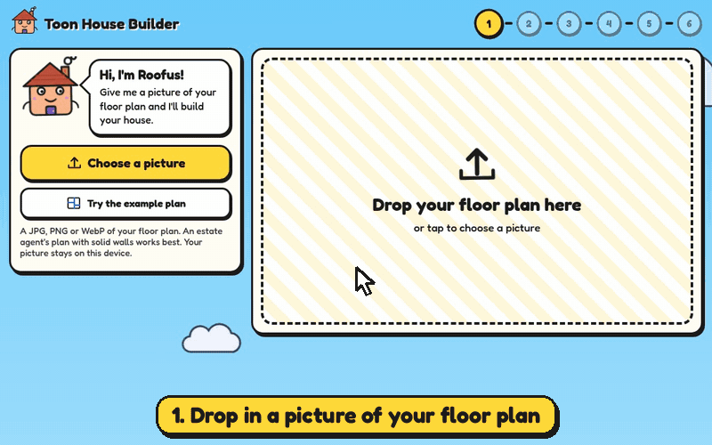

**Try it now:** [turn your floor plan picture into a house](https://digitaladaption.github.io/toon-house-card/importer/) · [play with the example house](https://digitaladaption.github.io/toon-house-card/demo/)

| Ground floor | Upstairs | "brick" theme |
|---|---|---|
|  |  |  |

## What it does

- **Start from a picture.** An importer page reads a floor plan image and drafts the house for you.
- **Your floor plan, in 3D.** Flat cartoon colours, thick ink outlines, patterned floors, a blue sky with puffy clouds.
- **Three kinds of view.** One cutaway per floor (walls cut low so you can see in), and the whole house from outside with the roof on. Drag to turn, pinch or scroll to zoom.
- **Devices in the right place.** A blind sits on its window and its slats move with the real position. Lights glow and light the floor. Radiators turn orange when heating. The garage door opens.
- **Real weather.** Point it at your weather report and it rains on the house when it rains outside. Snow settles on the roof, fog rolls in, lightning flashes, and at night the stars come out and the windows glow.
- **Tap to control.** Tapping a light or switch toggles it. Tapping anything else opens its normal Home Assistant details. Hold a lamp for its colour and other controls.
- **Tap a room.** A panel lists everything in it: switch and dim the lights, move the blinds, turn the radiator up or down.
- **Replay the day.** Wind the house back through the last 24 hours and watch the lights, blinds, heating and weather as they were.
- **The family too.** A cartoon week calendar with a face for each person, a chore chart where chores win stars, and the family standing in the rooms they are in.
- **Fills itself in.** If your devices have areas in Home Assistant, the editor can sort them into the right rooms for you.
- **A cartoon editor.** Tap a light, blind or radiator and a little house called Roofus helps you set it up: pick the real device, try it, done. No code needed.
- **Plan ahead.** A device with no entity is drawn grey as "planned", so you can lay out kit you have not bought yet.
- **One file, no internet.** The 3D library and the font are bundled in, so it works on a local-only setup.
- **Light on the tablet.** It only redraws when something changes (or while rain or snow is falling).

## Install

### HACS (custom repository)

1. In HACS, open the menu and choose **Custom repositories**.
2. Add this repository's address and choose the type **Dashboard**.
3. Find **Toon House Card** in HACS and download it.
4. Reload your browser.

### By hand

1. Copy `dist/toon-house-card.js` to `config/www/toon-house/` on your Home Assistant.
2. Go to **Settings → Dashboards → ⋮ → Resources → Add resource**.
3. Enter `/local/toon-house/toon-house-card.js` and choose **JavaScript module**.
4. Reload your browser.

## Quick start

Add a card to a dashboard and paste this. It is a small bungalow you can change into your own house.

```yaml
type: custom:toon-house-card
view: ground
layout:
  title: My house
  floors:
    - id: ground
      name: Ground
      rooms:
        - { id: living, name: Living room, rect: [0, 0, 5, 4] }
        - { id: kitchen, name: Kitchen, rect: [5, 0, 8.5, 4] }
        - { id: hall, name: Hall, rect: [0, 4, 8.5, 5.6] }
      openings:
        - { room: hall, wall: s, at: 3.8, width: 1, kind: frontdoor }
        - { room: living, wall: n, at: 1.5, width: 2, kind: window }
        - { room: kitchen, wall: n, at: 6, width: 1.5, kind: window }
        - { room: living, wall: s, at: 2, width: 0.85, kind: door }
        - { room: kitchen, wall: s, at: 6.2, width: 0.85, kind: door }
      furniture:
        - { type: sofa, x: 2.5, y: 3.3, rot: 180 }
        - { type: table, x: 6.8, y: 2.2 }
      devices:
        - { name: Living room light, kind: light, x: 2.5, y: 2, entity: light.living_room }
        - { name: Living room blind, kind: cover, room: living, wall: n, at: 2.5, entity: cover.living_room }
```

A dashboard view set to **Panel (1 card)** gives the card the whole screen.

For a bigger house it is easier to keep the house in its own file. Save it as `config/www/toon-house/house.json` and point the card at it:

```yaml
type: custom:toon-house-card
layout: /local/toon-house/house.json
```

[`examples/example-house.json`](examples/example-house.json) is the two-storey house in the pictures above. Copy it and change the numbers.

## Start from a floor plan picture

**[Open the importer](https://digitaladaption.github.io/toon-house-card/importer/)** and drop in a picture of your floor plan. It finds the rooms, doors and windows and writes the house file for you. It runs in your browser and the picture stays on your computer.


A little house called Roofus walks you through it: set the size from one room, name the rooms with stickers, mark the front door and save `house.json`. It works on phones and tablets, and children can do it. It works best on plans with solid walls, like most estate agent plans. See **[docs/importer.md](docs/importer.md)**.

## How to describe your house

Everything is measured in **metres** on a simple grid, looking down at the plan:

- `x` runs left to right.
- `y` runs from the **back** of the house (small numbers) to the **front** (big numbers). The front door normally faces the bottom of the plan.
- Walls are named by compass side of the room on that plan: `n` is the back wall, `s` the front wall, `w` the left, `e` the right.

A room is a rectangle `rect: [left, back, right, front]`, or a list of corner `points` for an L-shape. Rooms that share a wall should share the same number for that edge. You do not draw walls: the card works them out from the rooms.

The full list of options (openings, furniture, devices, roofs, garden, colours) is in **[docs/house-file.md](docs/house-file.md)**.

### Tips

- Start with the ground-floor rooms only. Add doors and windows once the rooms look right.
- An estate agent's floor plan usually gives room sizes. Work across the house adding widths to get each room's left and right, and depths to get its back and front.
- If something is wrong (a window on an inside wall, a device in a room that does not exist), an orange **!** button appears on the card. Tap it for a plain-language list.
- You do not need a roof section. Without one, the card puts a pitched roof on the top floor and flat roofs on any lower part that sticks out.

## Set it up without typing

Edit the card on your dashboard and you get a cartoon editor instead of a box of code.

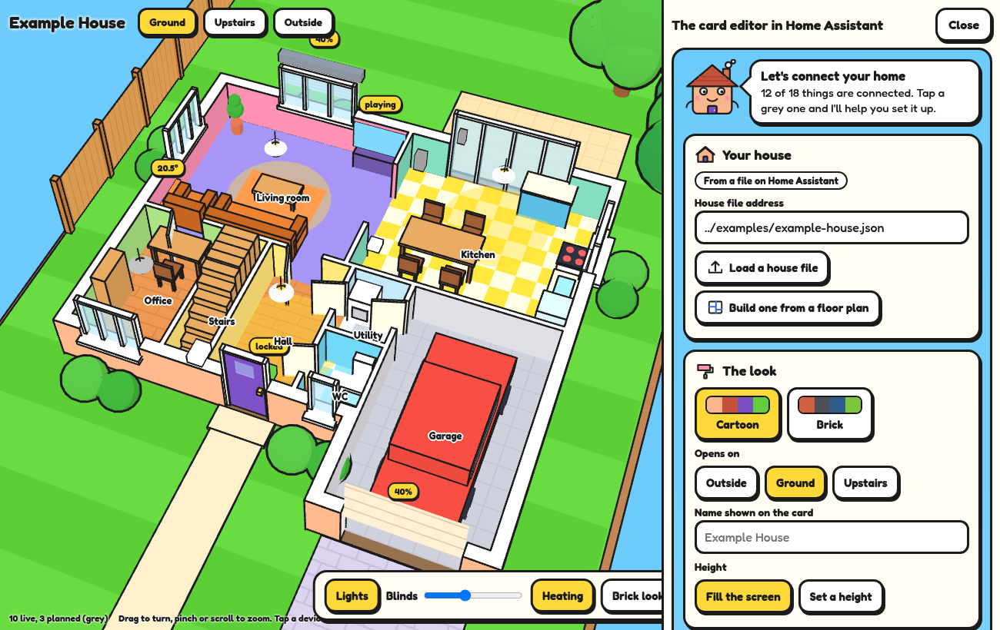

- **Your house**: point at a house file, or load one straight into the card so there is nothing to copy onto the server.
- **The look**: cartoon or brick colours, which view opens first, the weather report to follow, the name and the height.
- **Add or move things**: pick a sticker (light, blind, radiator, lock, camera...) and tap the little plan where it goes. Blinds snap onto the nearest window and radiators onto the nearest wall. Drag anything to move it.
- **Find my things by room**: one button matches your rooms to Home Assistant's areas ("Living room" finds an area called "Lounge") and offers to put each area's lights, blinds, radiators and sensors on the plan, already connected. Grey things already waiting in a room are connected instead of doubled. If a room's name is nothing like its area, add `area: Area name` to the room in the house file.
- **Connect your things**: every light, blind, radiator and sensor in the house is listed by floor. Grey ones are not connected yet.

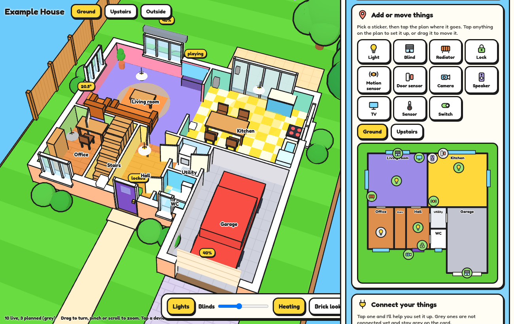

### The setup window

While you are editing the card, tap anything, on the plan, in the list or on the 3D house itself, and its setup window opens. It connects devices that are already in Home Assistant; it does not pair new ones. It has three steps:

1. **Pick it.** Your real devices of the right kind, with the best guesses for that room at the top. It uses your Home Assistant areas and the device names, and knows that a lounge is a living room. There is a search box, and "I haven't got it yet" keeps it grey.
2. **Try it.** The live reading, and buttons to switch a light, move a blind or nudge a radiator up or down, so you can see it is the right one. Nothing is switched unless you press a button, and locks are never touched.
3. **Finish.** Name it, move it or remove it.

**Just bought it?** In step 1, press **I've got a new one to add**. The window tells you how to pair it with Home Assistant, opens the devices page beside the editor, and watches. The moment the new device appears, Roofus shows it and one tap connects it. (Pairing itself is Home Assistant's job: a Zigbee valve needs a Zigbee stick, for example.) On the demo page a pretend valve joins after a few seconds so you can see it happen.

| Pick it | Try it |
|---|---|
| 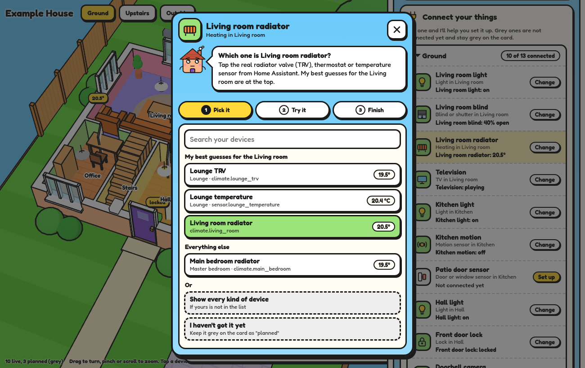 | 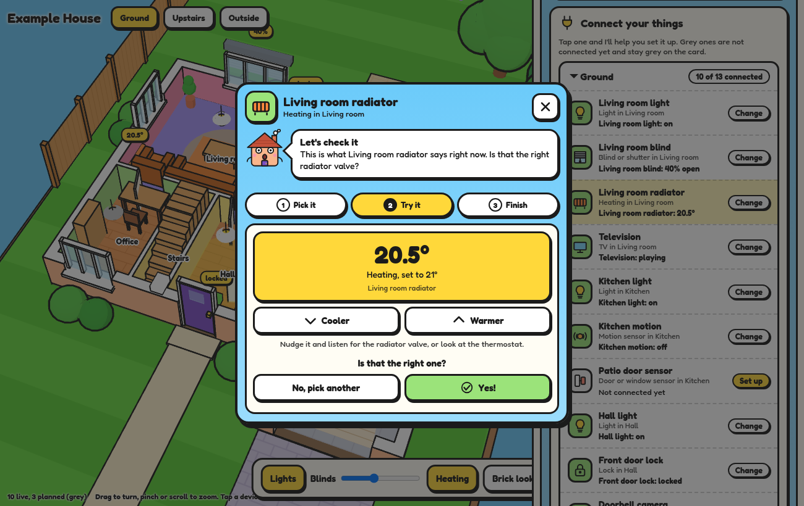 |

What you add, move and connect is saved in the card's own settings, not in the house file, so it survives when you rebuild the house file. You can try the editor on the [demo page](https://digitaladaption.github.io/toon-house-card/demo/?editor).

## Rooms, replay and old tablets

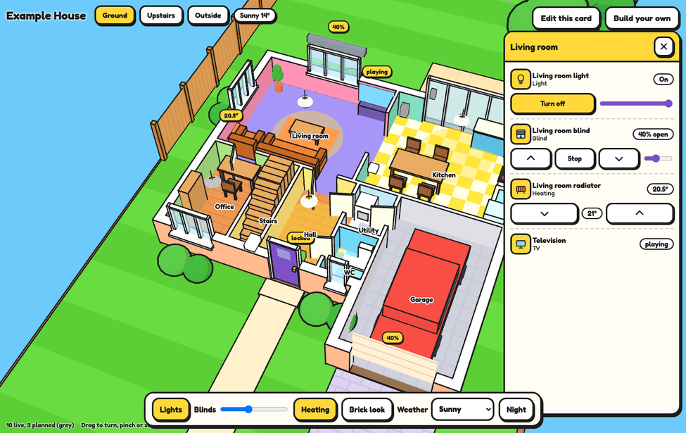

- **Tap a room** in one of the floor views and its panel opens. Lights get an on/off button and a dimmer, blinds get open, stop, close and a position slider, radiators get up and down. Tap a name for the full Home Assistant controls. Tap the room again, or the cross, to close it.
- **Hold a device** for about half a second to open its full Home Assistant controls, such as a lamp's colour.
- **Replay** (the button by the title) fetches the last 24 hours from Home Assistant's history. Drag the slider or press Play. Nothing can be switched while you are looking at the past; press **Back to now** first. Set `replay: false` to hide the button.
- **Detail**: `quality: light` is for older tablets (plain pixels, no edge smoothing, half the rain and snow). Left alone, the card starts in full detail and drops to light by itself if falling rain or snow makes it stutter. `quality: full` stops it doing that.

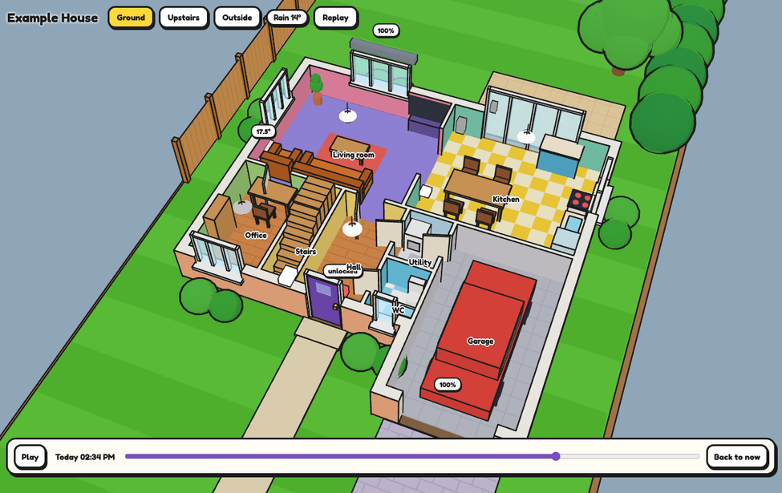

## The family: calendar, chores and who is where

The same file brings two more cards, in the same cartoon style, for a family wall tablet. They run on what Home Assistant already has, so there is nothing else to install. Try them on the [family demo](https://digitaladaption.github.io/toon-house-card/demo/family.html).

| Calendar | Chores |
|---|---|
| 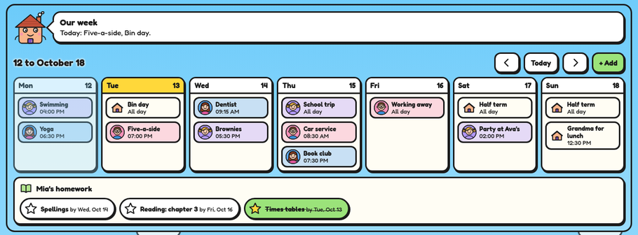 | 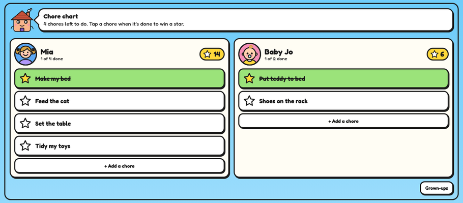 |

### People

All three cards take the same `people` list. Each person gets a cartoon face: pick a ready-made `look` (`dad`, `mum`, `girl`, `boy`, `baby`, `gran`, `grandad`) or shape your own, and give them a `colour` if you like.

```yaml
people:
  - name: Mum
    look: mum
  - name: Dad
    look: { type: dad, glasses: true, beard: true, hair: "#222222", skin: brown, top: "#58C472" }
  - name: Mia
    look: girl
    picture: /local/faces/mia.png     # or use your own picture instead of a drawn face
```

`skin` is `peach`, `fair`, `tan`, `brown`, `dark` or `sunny`, or any colour. Without a `look`, a person with a `person` entity uses that entity's picture.

### Calendar card

```yaml
type: custom:toon-calendar-card
title: Our week
people:
  - { name: Mum, look: mum, calendar: calendar.mum }
  - { name: Dad, look: dad, calendar: calendar.dad }
  - { name: Mia, look: girl, calendar: calendar.mia }
calendars:
  - { entity: calendar.family, name: Everyone }      # shared calendars get a little house
homework: todo.homework                               # optional: a to-do list shown under the week
```

- A week from Monday, today picked out, with each event wearing its person's face and colour. On a phone the days stack.
- **+ Add** puts something new on a person's calendar from the tablet: what, who, which day, and a time (or leave it empty for all day). It works with calendars Home Assistant can write to, such as a Local Calendar.
- `homework` shows a to-do list as tickable stars, with the due day if the item has one.
- Other options: `days` (1 to 14, default 7), `start: today` to begin at today instead of Monday, `homework_title`.

### Chores card

```yaml
type: custom:toon-chores-card
people:
  - { name: Mia, look: girl, chores: todo.mia_chores, stars: counter.mia_stars }
  - { name: Sam, look: boy, chores: todo.sam_chores, stars: counter.sam_stars }
```

- Each person's chores are a Home Assistant to-do list (Settings, Devices and services, Add integration, **Local To-do**). Tap a chore when it is done: it turns green, wins a star and Roofus cheers. Finish them all for confetti. Tap again to undo.
- `stars` is optional: a **Counter** helper that keeps the running total. Without it, the stars shown are today's ticked chores.
- **+ Add a chore** has ready-made ideas. **Grown-ups** shows a cross on each chore to take it away, and **Start a new day**, which unticks everything and keeps the stars.

### Who is where, in the house

Give the house card the same `people` and they stand in the rooms they are in:

```yaml
type: custom:toon-house-card
layout: /local/toon-house/house.json
people:
  - { name: Mum, look: mum, person: person.mum, room: sensor.mum_phone_area }
  - { name: Dad, look: dad, person: person.dad }
```

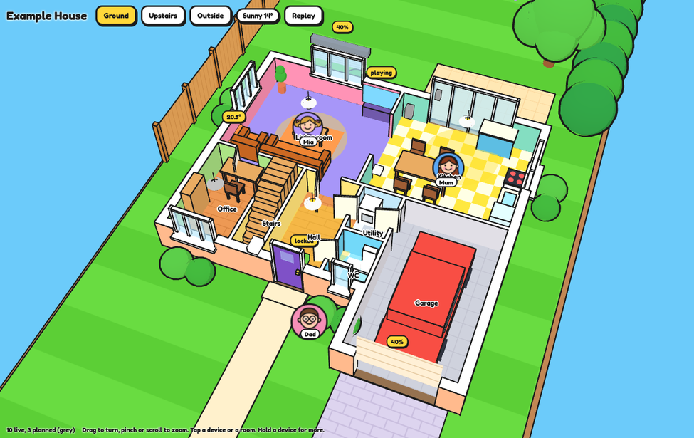

- `room` is any entity whose state is the name of a room or of a Home Assistant area. Bluetooth room tracking makes these (Bermuda or ESPresense, with a few cheap Bluetooth proxies round the house). "Lounge" finds a room called Living room.
- `person` says home or away. Someone who is home, with nothing to say which room, stands by the front door. Someone away is not drawn.
- A motion sensor only knows that somebody is in a room, not who, so the card never guesses a name from one.
- People are drawn in the floor view for their floor, and they are part of Replay.

## Weather

| Rain | Snow | Night |
|---|---|---|
| 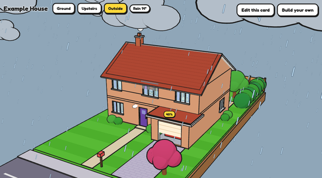 | 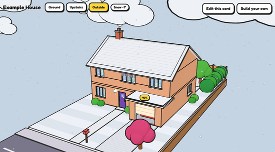 | 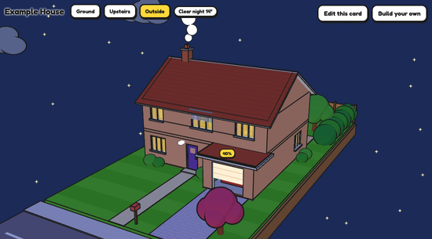 |

Give the card a weather entity and the sky follows it:

```yaml
type: custom:toon-house-card
layout: /local/toon-house/house.json
weather: weather.home
```

Or pick it in the card editor under **The look → Weather outside**. Any Home Assistant weather integration works (Met Office, Met.no and so on).

- Rain, heavy rain, thunder, snow, sleet, fog and cloud are all drawn. Snow turns the roof and garden white.
- Night comes from Home Assistant's `sun.sun`. The windows glow yellow if a light in the house is on, and go dark if not.
- Rain and snow fall in the outside view only, so it never rains in your kitchen. The floor views just get the grey sky.
- Falling rain and snow redraw the card at most about 30 times a second, and only while it is on screen. On dry days it still redraws only when something changes. If your device is set to reduce motion, the sky changes but nothing falls.
- To try a look without waiting for the weather, set `weather` to a fixed word: `rain`, `pour`, `storm`, `snow`, `sleet`, `fog`, `cloudy`, `partly` or `clear`, with `-night` on the end if you like (`snow-night`).

## Card options

| Option | Default | What it does |
|---|---|---|
| `layout` | required | The house: an address such as `/local/toon-house/house.json`, or the house written straight into the card |
| `view` | `outside` | Which view opens first: `outside`, or a floor `id` such as `ground` |
| `theme` | `toon` | `toon` (bright cartoon colours) or `brick` (closer to a real brick house) |
| `colours` | | Change single colours, for example `{ exterior: "#F4E285", door: "#D7263D" }` |
| `title` | from the house | Text shown top left. Use `""` for none |
| `height` | fills the screen | Card height, for example `600` or `70vh` |
| `cut_height` | `1.2` | How high the walls are cut in the floor views, in metres |
| `entities` | | Links made in the editor: device id to entity, for example `{ kitchen_light: light.kitchen }`. They win over the house file. `null` forces a device back to grey |
| `devices` | | Things added or moved in the editor, by device id. A new id adds a device (with its `floor`); an id from the house file changes that one; `null` hides it |
| `weather` | | A weather entity such as `weather.home`, and the sky follows it. Or a fixed word such as `snow` or `rain-night`. Leave out for an always-sunny day |
| `sun` | `sun.sun` | The entity that says whether it is night |
| `quality` | `auto` | `full`, `light` (for older tablets), or `auto` to let the card choose |
| `replay` | `true` | `false` hides the Replay button |
| `people` | | The family, drawn in the rooms they are in. See [the family](#the-family-calendar-chores-and-who-is-where) |
| `planned_path` | | A dashboard path to open when a planned (grey) device is tapped |

## Devices

| `kind` | Drawn as | Works with |
|---|---|---|
| `light`, `switch` | Hanging lamp that glows | `light`, `switch`, `input_boolean` |
| `cover` | Roller blind on its window, or the garage door | `cover` (uses `current_position`) |
| `climate` | Radiator on a wall, or a thermostat | `climate`, temperature sensors |
| `lock` | Small block: green locked, red unlocked | `lock` |
| `motion`, `contact` | Small block that lights up | `binary_sensor` |
| `camera`, `speaker`, `tv` | Camera, speaker, television | `camera`, `media_player` |
| `sensor` | Small block with its reading | any `sensor` |

Place a device either at a spot (`x`, `y`) or on a wall (`room`, `wall`, `at`). A `cover` placed on a wall finds the window, patio door or garage door at that spot by itself.

## Try it without Home Assistant

The [demo page](https://digitaladaption.github.io/toon-house-card/demo/) shows the example house with stand-in devices. To run it and the importer from your own copy instead:

```bash
python3 -m http.server 8000
```

Then open `http://localhost:8000/demo/`. Add `?layout=/path/to/your-house.json` to try your own file. The importer is at `http://localhost:8000/importer/`.

## Building from source

```bash
npm install
npm run build
npm test
```

The source is in `src/`. `npm run build` writes `dist/toon-house-card.js` and `importer/importer.js`.

## Good to know

- It needs a browser with WebGL2, which covers current phones, tablets and desktops. Where that is missing the card shows a message instead of the house.
- Openings and wall-mounted devices use the room's outer rectangle, so they work best on straight, square-on walls.
- The house file describes where your doors, locks and cameras are. Think before posting your own file in public.

## Licence

MIT. See [LICENSE](LICENSE). The bundled libraries (three.js and Clipper) keep their own licences, listed in [THIRD_PARTY_LICENSES.md](THIRD_PARTY_LICENSES.md).
