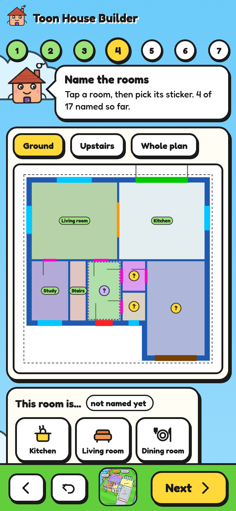

# Start from a floor plan picture

The importer turns a picture of a floor plan into a house file. It runs in your browser: the picture is never uploaded anywhere.


## Open it

**[https://digitaladaption.github.io/toon-house-card/importer/](https://digitaladaption.github.io/toon-house-card/importer/)**

Or run it from a copy of this project:

```bash
python3 -m http.server 8000
```

Then open `http://localhost:8000/importer/`. To try it straight away, use [`examples/example-plan.png`](../examples/example-plan.png).

## Steps

Roofus, the little house in the corner, tells you what to do at each step. Use **Next** and **Back** at the bottom, or tap a numbered step at the top. **Undo** takes back the last change.

1. **Pick your plan.** Choose a JPG, PNG or WebP, or press **Try the example plan**. For a PDF, take a screenshot.
2. **Check the rooms.** Each room it found is coloured in. If that looks wrong, press **Not quite**: you can show it a wall, turn the picture so the front is at the bottom, or draw a box round a floor it missed.
3. **Set the size.** Tap a room and type its size as printed on the plan. One number is enough. Or press **Measure a line instead** and drag along a length you know.
4. **Name the rooms.** Tap a room and pick its sticker, or type a name. The name sets its colours: a kitchen gets a checked floor, a bathroom gets tiles. Under **Something looks wrong?** you can add a wall to split a room, join two rooms, or remove something that is not a room.
5. **Doors and windows.** Tap a coloured strip to change what it is. Tap your front door until it turns purple.
6. **Stack the floors.** If there is an upstairs, check it sits in the right place and nudge it with the arrows.
7. **Save.** Press **Save my house** to download `house.json`, put it in `config/www/toon-house/` and point the card at `/local/toon-house/house.json`.

The 3D house updates as you go. On a phone it is the small picture in the bar at the bottom: tap it to look.



Then add your devices to the file by hand: see [the house file guide](house-file.md#devices).

## What to expect

It works well on plans with solid or thick walls in one colour, like most estate agent plans. Plans drawn with thin lines, low-resolution pictures and plans with coloured room fills need more fixing by hand.

It cannot read text, so it does not know room names or the printed sizes. It guesses the scale by assuming the house is about 10 m across, which is why setting the scale comes first.

Windows are recognised by the lines drawn across them. Patio doors drawn the same way as windows come out as windows: click them to change.

Walls at an angle, curved walls and split levels are not handled. Draw those rooms as the nearest rectangle.
